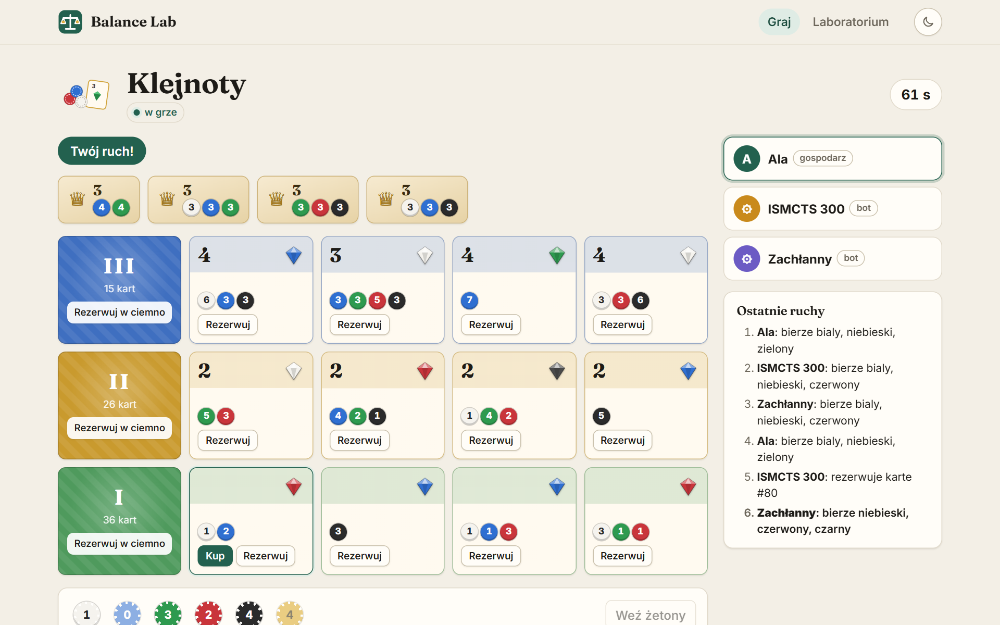
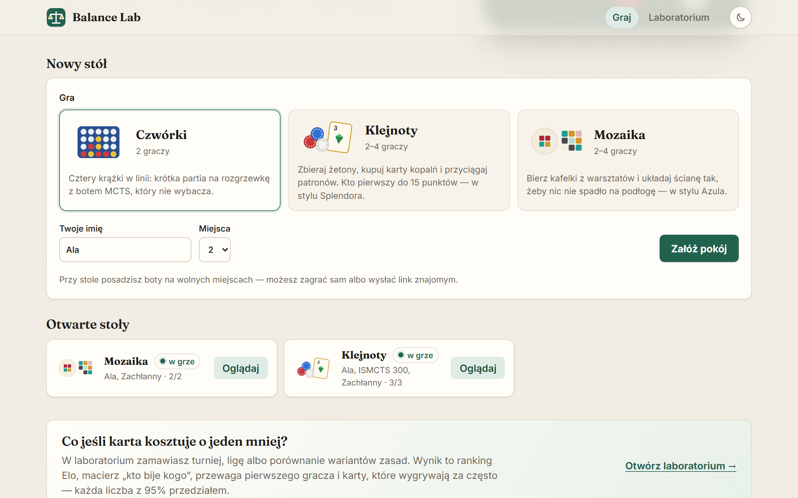
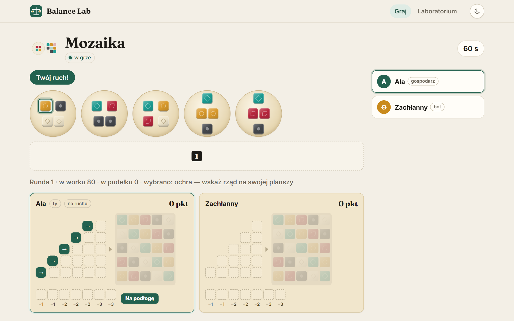
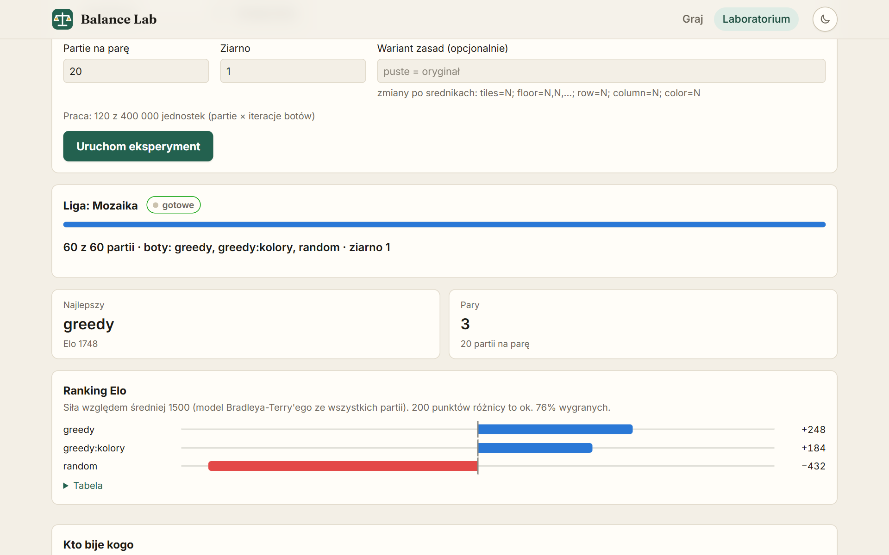
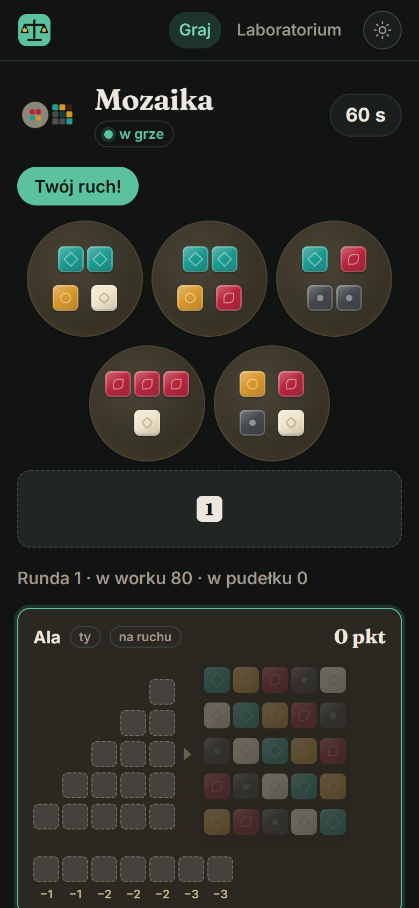

# Balance Lab

[Polski](README.md) · **English**

A balance lab for board games. Game rules plug in as a module, bots (MCTS) play thousands of games, and the
report shows what is unbalanced: first-player advantage, dominant strategies, overpowered and dead cards,
and what a rule change actually does. The same engine runs a live multiplayer table in the browser.




| Lobby | Mozaika | Balance lab | Phone, dark theme |
|---|---|---|---|
|  |  |  |  |

## Run it

```bash
docker compose up        # http://localhost:8080 — lobby, tables, replays and the lab
```

One image: the ASP.NET Core server (SignalR hub + REST) also serves the built React front end, next to
PostgreSQL for the match journal. Without Docker: `dotnet run --project src/BalanceLab.Api` with
`BALANCE_LAB_DB` set and `Web__Root=web/dist` after `cd web && pnpm build`.

## What is inside

- **Three games**: Czwórki (Connect Four on bitboards), Klejnoty (a Splendor-like card game with hidden
  decks and reserved cards) and Mozaika (an Azul-like tile game). Mozaika was added as the architecture test:
  a new project and one catalog entry — the engine, bots, simulator, journal, rooms, server and CLI did not
  change by a single line (a CI job diffs them between the two release tags).
- **Engine contract**: pure functions over immutable state (`Setup`, `LegalMoves`, `Apply`, `Scores`,
  `Determinize`, `Hash`). Every game is reproducible from its seed with a custom PCG32 generator and a
  deterministic logarithm, so a tournament gives the same report on Windows and Linux.
- **Bots**: random, greedy (with strategy profiles), MCTS (UCT) and ISMCTS for hidden information — the bot
  only ever sees a determinized view, so it cannot peek at the deck even by accident.
- **Simulator and report**: parallel tournaments with seat rotation and Wilson intervals, a league with Elo
  fitted by Bradley–Terry (MM), A/B comparison of rule variants on the same deals with Newcombe intervals,
  card/tile statistics judged within their group, and a self-contained HTML report.
- **Match journal** in PostgreSQL: append-only moves (enforced by triggers), a hash per move, snapshots every
  20 moves, optimistic concurrency, and full verification that replays the game and points at the first
  diverging move.
- **Live play** over SignalR: each room is an actor with one queue (no locks), the server is the referee,
  each seat gets its own view of hidden information, bots take over after a timeout or disconnect, and a
  page reload rejoins the same seat.
- **Front end** (React 19 + TypeScript): lobby, three boards, replay player with a slider (frames computed by
  the server), the balance lab dashboard with charts, light and dark theme. The front end does not know the
  rules — every button comes from the server's list of legal moves (a fast-check property test proves no click
  sequence can build an illegal move).

## Tests

xUnit + FsCheck property tests, statistical tests, bot strength tests, NetArchTest architecture rules,
Testcontainers integration tests on real PostgreSQL, SignalR hub tests over WebSockets, Playwright e2e on the
real server, Vitest + Testing Library on the front end, and mutation testing on everything: Stryker.NET per
project and StrykerJS on the front end, all with a 90% break threshold in CI.

```bash
dotnet test
cd web && pnpm check && pnpm mutation && pnpm e2e
```

## Stack

.NET 10, ASP.NET Core + SignalR, EF Core + PostgreSQL, System.CommandLine, xUnit, FsCheck, Testcontainers,
NetArchTest, Stryker.NET, BenchmarkDotNet; React 19, TypeScript, Vite, zod, Vitest, Playwright,
dependency-cruiser, StrykerJS.

The detailed write-up (algorithms, measurements, design decisions) is in the [Polish README](README.md).

## License

MIT — [LICENSE](LICENSE).
